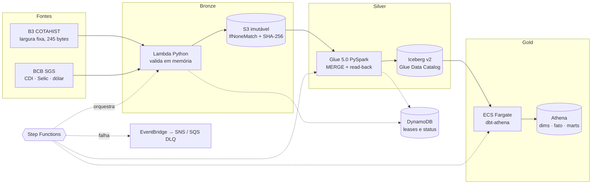

# B3 Lakehouse AWS

Lakehouse de dados de mercado brasileiro na AWS: **40 anos de cotações da B3 (1986–2025)** e séries do Banco Central (CDI, Selic e dólar), da fonte oficial até tabelas analíticas, com ingestão serverless, Spark, Apache Iceberg, dbt e infraestrutura como código — tudo dentro de um **teto total de USD 10**.

     

## Em números

| | |
| --- | --- |
| **3.185.477** | cotações na camada silver (lote padrão, mercado à vista) |
| **29.917** | observações diárias de CDI, Selic e dólar |
| **40 anos** | de histórico, do cruzeiro ao real, sem converter valores antigos |
| **374** | linhas inválidas isoladas em quarentena, sem descartar anos inteiros |
| **0** | chaves AWS estáticas: CI só com OIDC e ambientes protegidos |
| **USD 10** | teto total do projeto, com USD 2 de reserva e aprovação de custo por etapa |

Contagens das [evidências do histórico](docs/history-complete-evidence.md), registradas na conclusão das cargas.

## Arquitetura



| Camada | Implementação | Garantias |
| --- | --- | --- |
| Bronze | Lambda Python → S3 | ZIP nunca extraído em disco, limites de tamanho, header/trailer conferidos, objetos imutáveis, reexecução idempotente |
| Silver | Glue PySpark → Iceberg v2 | Hash da bronze conferido, MERGE por `(data, ticker)`, read-back com `exceptAll` nos dois sentidos antes de marcar SUCCESS |
| Gold | dbt-Athena em Fargate | Contratos da silver testados antes de escrever (falha fechada), `dbt build --fail-fast`, prazo de 20 min |
| Orquestração | Step Functions + Scheduler | Lease global, retomada sem repagar etapas, feriado explícito, alertas e DLQ |
| Plataforma | Terraform + GitHub Actions | Plan em PR, apply do plano exato e criptografado com aprovação, permission boundaries por componente |

## Decisões de engenharia

- **Glue em vez de EMR Serverless.** A conta FREE bloqueou o EMR. Em vez de converter a conta, o backfill foi reescrito para Glue com o mesmo código de parse — [registro do bloqueio](docs/emr-subscription-block.md) e [alternativa](docs/history-glue.md).
- **Step Functions em vez de MWAA.** Orquestrar uma execução diária curta não justifica um ambiente Airflow cobrado por hora.
- **Gold sem partição, de propósito.** O CTAS do Athena limita a escrita a 100 partições; 40 anos particionados por mês estourariam. Com o volume atual, o rebuild completo é mais simples e barato.
- **Preços brutos, sem ajuste inventado.** Fator de cotação e moeda original são preservados; mudanças de moeda ou fator bloqueiam o retorno comparável, e variações ≥ 30% são sinalizadas como *possíveis* eventos corporativos, nunca afirmadas.
- **Lacunas ficam visíveis.** CDI ausente permanece `NULL` e bloqueia a comparação, em vez de ser interpolado.
- **Custo como requisito.** Cada etapa paga teve estimativa, gate (`scripts/cost_gate.py`) e aprovação antes de rodar; sem NAT Gateway, clusters fixos ou serviços sempre ligados.
- **Fargate sem NAT.** Sub-rede pública com IP só durante a tarefa, sem ingress e com egress apenas HTTPS.

## Estado do projeto

Separando o que foi **validado na AWS**, o que está **implementado e testado offline** e o que **falta**:

| Componente | Estado |
| --- | --- |
| Bootstrap, estado remoto, budgets, OIDC | ✅ Implantado e validado |
| Bronze (Lambda, S3, DynamoDB) | ✅ Implantado; carga real e idempotência verificadas |
| Silver (Glue, Iceberg) | ✅ Implantado; incremental, repetição e histórico 1986–2025 validados |
| Gold (dbt: 3 dimensões, fato, 2 marts) | ✅ Implantado; piloto Fargate com 25/25 modelos e testes e reconciliação com a silver ([evidências](docs/gold-evidence.md)) |
| Orquestração, alertas, DLQ, painel | 🧪 Implementado e simulado offline ([fase 5](docs/phase-5.md)); implantação pendente |
| Agendamento diário | ⏸️ Desligado por decisão de custo |

Próximos passos: pilotos da orquestração ([USD 0,90](docs/costs/orchestration.md)) e evidências finais. O plano detalhado está em [CONTINUIDADE.md](docs/CONTINUIDADE.md).

## Dados e semântica

- **B3 COTAHIST:** layout oficial rev. 02, escopo `CODBDI=02` e `TPMERC=010`. [Detalhes da silver](docs/phase-3.md).
- **BCB SGS:** séries 12 (CDI), 11 (Selic) e 1 (dólar venda); taxas em % ao dia, dólar antes de 07/1994 na unidade `moeda vigente/USD`.
- **Gold:** `dim_asset`, `dim_calendar`, `dim_rates`, `fct_daily_quotes`, `mart_daily` (retorno, excesso sobre CDI, volatilidade, liquidez) e `mart_monthly`. [Semântica e limitações](docs/phase-4.md) e [consultas de exemplo](docs/gold-queries.sql).

## Testes

Tudo roda offline — nenhum teste chama AWS ou internet:

- **Python (pytest):** parsers e validações do COTAHIST/BCB, idempotência da bronze, empacotamento determinístico, gate de custo, criptografia do plano.
- **SQL da gold:** os modelos dbt reais são renderizados com Jinja, traduzidos de Trino para DuckDB com SQLGlot e executados sobre dados sintéticos.
- **Orquestração:** a definição real do Step Functions é simulada com um avaliador JSONata, cobrindo sucesso, repetição, feriado, falhas, retomada e concorrência.
- **Terraform:** `terraform test` com provider simulado verifica restrições de segurança e custo (timeouts, concorrência 1, zero retries, sem agendamento, boundaries, ausência de curingas).

```bash
python -m pip install -r scripts/requirements-ci.txt
python -m pytest tests -q
terraform -chdir=infra/modules/orchestration init -backend=false && terraform -chdir=infra/modules/orchestration test
```

O workflow [`ci.yml`](.github/workflows/ci.yml) roda também `dbt parse`, o build da imagem e `validate`/`test` de todos os módulos Terraform.

## Estrutura

```text
src/                    Ingestão (Lambda) e processamento Spark (silver e histórico)
dbt/                    Modelos gold, contratos e contêiner
infra/bootstrap/        Estado remoto, papéis OIDC e permission boundaries
infra/modules/          bronze, silver, history, gold, orchestration, budget
infra/environments/dev/ Composição com flags de implantação
scripts/                Builds determinísticos, preparação do histórico, preflight e gate de custo
tests/                  Testes offline
docs/                   Evidências, decisões, custos, operação e plano de conclusão
```

## Custo e regras de operação

- Teto **total** de USD 10 (não mensal), com USD 2 reservados; consumo bruto, sem descontar créditos. Budgets alertam, mas não bloqueiam.
- Toda operação com custo tem estimativa e aprovação prévia; o CI implanta infraestrutura, mas não recebe permissão para iniciar workloads pagos.
- Plano FREE preservado; sem NAT Gateway, MWAA, RDS ou clusters fixos.
- Credenciais apenas temporárias: OIDC no CI e CloudShell na operação.
- Publicar como realizado somente o que tem evidência; implementado ou simulado não é implantado.

## Evidências

- [Fundação e consumo observado](docs/foundation-validation.md) · [OIDC](docs/oidc-check.md) · [Budgets](docs/budgets-evidence.md)
- [Primeira carga bronze](docs/bronze-data-evidence.md) · [Silver incremental e repetição](docs/silver-data-evidence.md)
- [Histórico 2025](docs/history-2025.md) · [Lotes históricos](docs/history-batch-evidence.md) · [Histórico consolidado](docs/history-complete-evidence.md)
- [Gold](docs/phase-4.md) · [Piloto gold](docs/gold-evidence.md) · [Orquestração](docs/phase-5.md) · [Operação](docs/operacao.md) · [Plano de conclusão](docs/CONTINUIDADE.md)

## Licença

[MIT](LICENSE).
