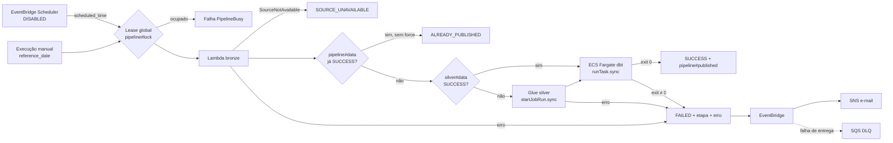

# Fase 5 — orquestração e confiabilidade preparadas

Estado em 20/10/2026: código, Terraform e testes offline prontos numa branch de revisão. **Nada desta fase foi implantado nem executado na AWS.** A implantação depende do piloto gold da fase 4 (a máquina de estados usa a task definition gold com digest revisado) e de aprovação específica de custo.

## Fluxo

A máquina de estados (`infra/modules/orchestration/pipeline.asl.json.tftpl`, Step Functions STANDARD com JSONata) reutiliza a Lambda bronze, o job Glue silver e a task dbt existentes. Não há segunda implementação de parser.

## Controles

| Risco | Controle |
| --- | --- |
| Duas execuções simultâneas (gold não é atômica) | Lease condicional em `pipeline#lock` no DynamoDB; segunda execução falha com `PipelineBusy` antes de qualquer trabalho. Lease de 65 min expira sozinho após execução abortada ou com timeout. |
| Repetição da mesma data | `pipeline#<data>` com SUCCESS encerra como `ALREADY_PUBLISHED` sem Glue nem Fargate. `force: true` reprocessa deliberadamente; bronze e MERGE silver já são idempotentes. |
| Retomada após falha | Se `silver#<data>` já é SUCCESS, a reexecução vai direto para a gold, sem pagar o MERGE de novo. |
| Retry transitório × erro de contrato | Só a Lambda tem retry: erros do serviço Lambda (2×) e de rede da fonte (1× após 5 min). Contrato inválido, Glue e Fargate nunca têm retry automático. |
| Feriado ou arquivo ainda não publicado | HTTP 404 ou série BCB vazia viram `SourceNotAvailable`. A execução termina `SOURCE_UNAVAILABLE`, não grava carga vazia; o bronze fica `FAILED/SourceNotAvailable` e pode ser repetido depois. |
| Publicação parcial da gold | Consumidores devem ler `pipeline#published`: só avança após exit code 0 do dbt (contratos de origem + `dbt build --fail-fast`) e nunca retrocede para uma data mais antiga. Exit code ausente é tratado como falha. |
| Execução presa | Timeout global de 60 min; timeouts por etapa (Lambda 4, Glue 20, Fargate 30 min). O dbt tem prazo interno de 20 min. |
| Falha silenciosa | Regra EventBridge para FAILED/TIMED_OUT/ABORTED → SNS e-mail; entrega malsucedida → SQS DLQ (SSE, 4 dias); alarme da DLQ e de erros da Lambda. Com agendamento ativo, alarme de três dias sem sucesso. |
| Agendamento duplicado | O scheduler do pipeline é `DISABLED` por padrão, sem retry, e a validação Terraform proíbe ativá-lo junto com o scheduler bronze antigo. |

Mensagens de alerta contêm apenas status e nome da execução. O SNS não usa a chave gerenciada `aws/sns` porque o EventBridge não consegue publicar com ela; não há dados de mercado nas mensagens. O e-mail vem do segredo já usado pelos budgets e não é gravado no repositório; a assinatura exige confirmação manual do proprietário.

## Permissões

`infra/bootstrap/orchestration-ci.tf` cria dois boundaries (Step Functions e Scheduler) com os mesmos templates das políticas de runtime, e políticas gerenciadas para os papéis de CI. O CI pode criar e atualizar os recursos, mas **não recebe `states:StartExecution` nem `ecs:RunTask`**: executar o pipeline continua sendo um ato do operador. O papel da máquina de estados só invoca a Lambda bronze, o job silver e a task gold no cluster gold, passa somente os papéis gold para `ecs-tasks.amazonaws.com` e escreve no DynamoDB apenas chaves `pipeline#*`.

## Validação offline

- `tests/test_orchestration.py` simula a definição real, avaliando as expressões JSONata com `jsonata-python` e integrações falsas: sucesso, repetição sem custo, `force`, data antiga sem retroceder a publicação, feriado, falha silver, exit code ≠ 0 e ausente, retomada sem silver, lease ocupado e lease expirado.
- O teste estrutural confere que todas as transições existem, todos os estados são alcançáveis, toda Task tem timeout e Catch, e Glue/Fargate não têm retry.
- `infra/modules/orchestration/tests/safety.tftest.hcl` e `infra/bootstrap/tests/orchestration.tftest.hcl` verificam agendamento desligado, boundaries, ausência de curingas, DLQ cifrada e que o CI não inicia execuções.

A simulação não substitui o piloto: a forma exata das respostas `.sync` do ECS e do Glue, a semântica JSONata do serviço e as permissões IAM só ficam comprovadas numa execução real. Antes do apply, validar a definição com `aws stepfunctions validate-state-machine-definition` (sem custo).

## Sequência de implantação

Depois do aceite da fase 4 (gold executada com sucesso):

1. Apresentar a [estimativa](costs/orchestration.md), conferir gasto atualizado com `scripts/cost_gate.py` e obter aprovação.
2. Aplicar o bootstrap com `enable_orchestration_permissions=true`, preservando as flags existentes.
3. Definir `ENABLE_ORCHESTRATION=true` e aplicar o plano revisado; confirmar a assinatura SNS no e-mail.
4. Piloto 1 — sucesso: `{"reference_date": "<último pregão>"}`. Conferir SUCCESS, `pipeline#published`, tabelas gold e custo.
5. Piloto 2 — repetição da mesma data: esperar `ALREADY_PUBLISHED` sem Glue/Fargate.
6. Piloto 3 — feriado nacional passado (ex.: `2026-10-12`): esperar `SOURCE_UNAVAILABLE`, sem carga.
7. Piloto 4 — falha controlada sem tocar no histórico: `{"reference_date": "2099-01-02"}` falha no contrato da bronze antes de gravar qualquer coisa; conferir `PipelineFailed.bronze` e o e-mail de alerta.
8. `ORCHESTRATION_SCHEDULE_ENABLED` permanece `false` até aprovação específica de recorrência, horizonte e mecanismo de parada.

Os comandos estão em [operação](operacao.md).
